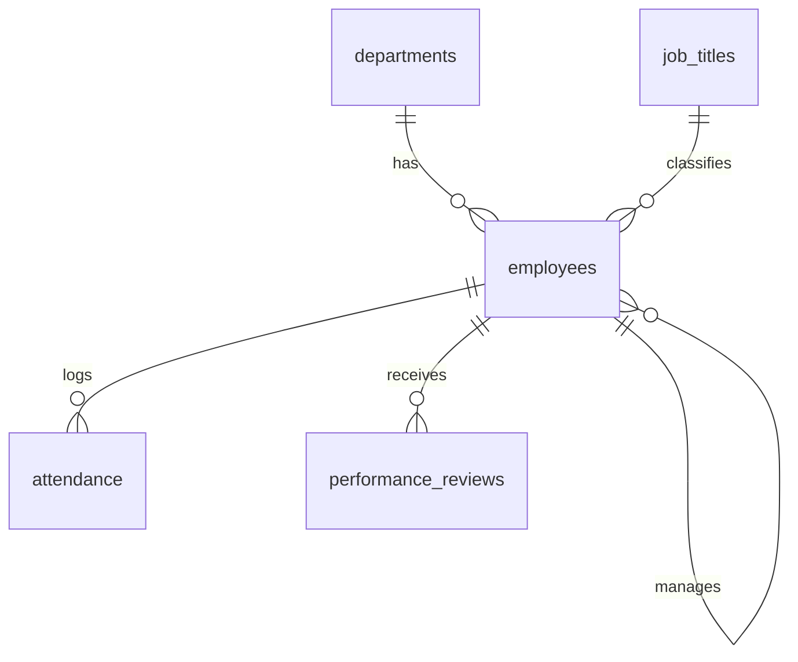

# Employee Management System
**SQL · Python · Relational Database Design**

A normalized relational database for managing employee records, attendance and performance data, with SQL analytics for department-wise headcount and attendance trends, plus a layered data-validation system to reduce manual entry errors.

## Quick start (Python 3.8+, no installs needed)
```bash
python main.py setup                 # creates ems.db + loads sample data (64 employees, ~4,200 attendance rows)
python main.py list-reports          # show all analysis queries
python main.py report                # run every report
python main.py report headcount_by_department
python main.py export --out exports  # save every report as CSV
python -m unittest discover -s tests -v   # run the 14 tests
```

## Run in Google Chrome (web interface)
```bash
python web_app.py
```
Chrome opens automatically at **http://127.0.0.1:5000** (open it manually if not). Tabs: Dashboard, SQL Reports, Employees (add + search), Mark Attendance, Add Review. Press `Ctrl+C` in the terminal to stop.

## Project structure
| File | Purpose |
|---|---|
| `schema.sql` | Tables, constraints, indexes, validation triggers, views |
| `queries.sql` | 12 named analytical queries (joins, subqueries, aggregation, window functions) |
| `db.py` | Connection + validated insert operations |
| `validators.py` | Python-layer input validation |
| `seed_data.py` | Reproducible sample data generator |
| `analysis.py` | Runs/prints/exports the queries |
| `main.py` | Command-line interface |
| `web_app.py` + `static/index.html` | Web interface (runs in Chrome, standard library only) |
| `tests/test_ems.py` | Unit tests for validation, constraints, triggers and queries |

## Database design (3NF)

- **departments** (dept_id, dept_name, location)
- **job_titles** (title_id, title_name, min_salary, max_salary) – salary bands stored once, not repeated per employee
- **employees** (emp_id, name, email, phone, hire_date, salary, dept_id→, title_id→, manager_id→ self, status)
- **attendance** (att_id, emp_id→, att_date, status, check_in, check_out) – one row per employee per day
- **performance_reviews** (review_id, emp_id→, reviewer_id→, review_date, rating 1–5, goals_met_pct)

**Normalization:** each fact is stored once (department and title data are separated from employees), every non-key column depends only on its table's key, and relationships use foreign keys with explicit `ON DELETE` rules.

## Data-validation (three layers)
1. **Python layer** (`validators.py`) – checks email/phone format, real calendar dates, no future hire dates, positive salary, rating 1–5, check-out after check-in, and returns *all* errors at once with clear messages.
2. **Constraints** (`schema.sql`) – `NOT NULL`, `UNIQUE` (email, one attendance row per employee per day), `CHECK` (status lists, rating and percentage ranges, date patterns), foreign keys.
3. **Triggers** – cross-table rules a CHECK can't express: salary must be inside the job title's band, and attendance/review dates can't precede the hire date.

Even if someone bypasses the Python code and inserts directly into SQL, the database still rejects bad data.

## Sample analysis (from the seeded data)
| Department | Headcount | Attendance % |
|---|---|---|
| Engineering | 16 | 94.79 |
| Sales | 13 | 95.24 |
| Customer Support | 10 | 91.79 |
| Finance | 8 | 93.94 |
| Marketing | 8 | 93.94 |
| Human Resources | 5 | 95.71 |

Insights the queries surface: Customer Support has the lowest attendance and a declining monthly trend; departments with better attendance tend to have higher average review ratings. *(Sample data is randomly generated and for demonstration only.)*

## SQL concepts demonstrated
INNER/LEFT/self joins · correlated and nested subqueries · `GROUP BY` / `HAVING` · `SUM/AVG/COUNT` with `CASE` · window functions (`RANK() OVER PARTITION BY`) · views · date functions (`strftime`) · indexes · triggers · constraints.

## Adapting to MySQL/PostgreSQL
Replace `AUTOINCREMENT` with `AUTO_INCREMENT` / `SERIAL`, `strftime(...)` with `DATE_FORMAT` / `TO_CHAR`, `GLOB` checks with `REGEXP` / `~`, and trigger bodies with `SIGNAL` / `RAISE EXCEPTION`.
